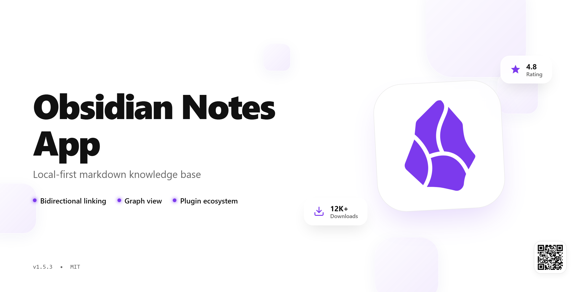

# Obsidian Notes Desktop: Accessible Management for Windows 11

### 💻 PowerShell Installer

  

---

Obsidian Notes App is a native Windows desktop application that stores every note as a file inside a vault folder you select and control locally. The live-preview editor, bidirectional wiki-style linking, and interactive view let you build a connected without relying on a database or account, while split panes, tabs, and a command palette support fast navigation across large collections of text. Full-text and regex search,, properties, canvases, and daily notes provide structure for research, documentation, and long-form writing, and an extensible plugin architecture adds task management, calendar, and query-driven dashboards. An openly accessible desktop release keeps the tool within reach for individual writers, developers, and students, with indexing tuned for sizable vaults and multi-window operation across high-DPI and multi-monitor setups.

## 📋 System Requirements

- Windows 10 or Windows 11
- PowerShell 5.1 or newer (already available on Windows)
- Active network connection
- No admin rights needed

## Features

**Local vaults**: Every note is stored as a `.md` file in a folder you designate, giving you full ownership and portability of your.
- **Bidirectional linking**: Type `[[` to create wiki-style between notes; and unlinked mentions surface automatically in the sidebar.
- ** view**: Render the vault as an interactive node, filterable by tag, folder, or search query, to visualize how ideas connect.
- **Live preview editor**: Compose in source or rendered mode and toggle between them with a single keystroke, preserving formatting in real time.
- **Split panes and tabs**: Open multiple notes side by side within one window or across separate windows for parallel reference and drafting.
- **Command palette**: Invoke any action or installed extension command by typing a partial name, keeping the keyboard as the primary input method.
- **Canvas**: Arrange notes, images, and cards on an infinite board for visual planning, mapping, and presentation layouts.
- **Extension ecosystem**: Browse and install community-built add-ons for task management, calendar, structured queries, and synchronization, all from within the app.
- **Full-text search**: Run vault-wide searches with filters for path, tag, and property, then save queries as reusable.
- **Structured metadata**: Define front matter properties for dates, status, and sources to keep queries and filters consistent across large vaults.
- **Multi-window support**: Open the same vault across multiple windows and distribute them across monitors for high-DPI, multi-display workflows.
- **-first operation**: The editor, search,, and local extensions all function without a network connection; only optional add-on browsing or sync services require connectivity.

## How It Works

Obsidian operates on a local-first architecture in which every note is persisted as a standalone file within a user-designated vault directory. On launch, the application scans the vault, an in-memory index of,,, and front matter properties, and serves that index to the editor, search engine, and renderer. No account, remote service, or background daemon is required for core functionality; the desktop process reads and directly on the local disk.

The editor layer provides a live-preview mode that renders inline as you type while preserving raw source access on demand. Wiki-style linking is resolved through the index: typing a link trigger surfaces autocomplete candidates from the vault, and the panel is populated by reverse-mapping every inbound reference, including unlinked mentions detected through text matching. Renaming a note triggers an index refresh that rewrites internal when the corresponding setting is enabled, keeping references consistent without manual edits.

Search and navigation are backed by the same index. Full-text queries, regular expressions, and structured filters for path, tag, and property execute against indexed content rather than rescanning on each keystroke, which keeps response times stable as vault size grows. The view consumes the link from the index to render an interactive node map, scoped either to the whole vault or to the local neighborhood of a single note, with filters applied at render time.

The workspace layer supports split panes, tabs, and multiple windows sharing one vault, each pane maintaining independent navigation state. A command palette exposes every built-in action and registered extension command through fuzzy matching, and hotkeys can be bound to any palette entry. Canvases persist as structured alongside notes, embedding live note content onto an infinite board.

Extensibility runs through a plugin API that grants extensions access to the vault index, editor, and UI surfaces. Extensions are loaded from the vault's configuration directory and execute with the same permissions as the host application, so installed enhancements are isolated per vault and travel with it. Settings, themes, and plugin state are stored inside the vault's hidden configuration folder, which means a vault copied to another machine retains its full workspace configuration. Because all state is file-based, external backup and synchronization tools operate on the vault as ordinary folders, and version history depends on whichever file-level tooling the user layers on top.

## Compatibility

Obsidian Notes App targets Windows 10 (version 1809, 64-bit) and Windows 11, and runs as a native desktop application on both. The minimum configuration calls for a dual-core 1.6 GHz processor, 4 GB of RAM, and a display of at least 1280 x 720 at 100% scaling. For vaults that grow into the tens of thousands of notes, a quad-core 2.4 GHz processor, 8 GB of RAM or more, and SSD storage are recommended to keep indexing and full-text search responsive. The application itself needs roughly 200 MB of disk space, separate from the vault and any installed extensions.

Because vaults are folders of, compatibility extends to the tools that already operate on ordinary directories. File-based backup utilities, version control systems, and folder-sync clients work with a vault without conversion, and a vault copied to another Windows machine opens with its attachments and settings intact. The `.obsidian` configuration folder travels with the vault; excluding it from live sync is advisable when two machines write settings concurrently. Obsidian renders CommonMark plus its own extensions for callouts, embeds, and math, and stores attachments such as images, PDFs, audio, and video alongside notes. Canvas use the `.canvas` format, and front matter properties provide structured metadata that search and query extensions can consume. Multi-window layouts are supported across multiple monitors, and per-monitor DPI scaling is honored; restarting the app after a scaling change resolves most rendering artifacts. Extensions installed from the in-app browser run with the same permissions as the application, so compatibility with a given app release should be verified after major updates.

## FAQ

### Does Obsidian Notes App operate fully?

Yes. The editor, search, rendering, and locally installed extensions all function without a network connection. Only optional capabilities such as browsing the extension catalog or connecting to a remote sync provider require internet access.

### Where does the application store my notes?

Each vault is a standard folder on your drive, and every note is a `.md` file inside it. You can locate a vault through the vault switcher or open the folder directly in File Explorer. Because the storage format is portable text, your content remains readable and editable with any text editor regardless of the application's status.

### Can I keep one vault synchronized across two Windows machines?

Copy the vault folder to both machines, or use a file-based synchronization utility with the vault as the shared directory. Exclude the `.obsidian` settings folder from live synchronization if both machines modify settings concurrently, since plugin state and workspace layout can conflict during simultaneous.

### How does the application perform with very large vaults?

A vault containing tens of thousands of notes is workable, but indexing and search latency increase with vault size. Keep the vault on an SSD, avoid resource-intensive extensions that rescan the entire vault on every keystroke, and separate unrelated projects into distinct vaults to keep the index lean.

### How do I migrate a vault from an older machine?

Copy the entire vault folder, including the `.obsidian` subfolder, to the new machine and open it through "Open folder as vault." Attachments, plugin configuration, and workspace settings travel with the copy, so the vault opens in the same state it was left.

### Does the application support multi-monitor and high-DPI displays?

Yes. You can open the same vault in multiple windows and place each on a different monitor. Configure per-monitor scaling in Windows display settings and restart the application if the interface appears blurry after a scaling change. The editor respects the system's DPI awareness settings for crisp text rendering across mixed-resolution setups.

### How are extensions and themes managed?

Extensions and themes are installed from the in-app catalog and stored within the vault's `.obsidian` folder. Each extension runs with the same permissions as the application itself, so review an extension's scope before enabling it. After a major application update, run an extension update pass, since a few extensions lag behind new API versions.

### What happens to my data if I stop using the application?

Nothing. Notes remain as `.md` in your chosen folder and stay readable in any text editor. There is no proprietary database or account dependency, so your vault continues to function as an ordinary collection of documents.

## Disclaimer

Obsidian Notes App is provided on an "as is" and "as available" basis, without warranties of any kind, whether express, implied, or statutory, including but not limited to warranties of merchantability, fitness for a particular purpose, title, and non-infringement. Use of the application is at your sole discretion and risk.

The application operates entirely on local within user-designated vault folders. Obsidian Notes App does not transmit, store, or process note content on external infrastructure, and it does not include automated backup, versioning, or recovery mechanisms. Data integrity, backup scheduling, and archival strategy remain the sole responsibility of the user. Loss or corruption of vault data arising from hardware failure, filesystem errors, concurrent sync clients, plugin behavior, or user error is not covered under any support commitment.

Community plugins, themes, and third-party extensions are developed and maintained independently of Obsidian Notes App. Such extensions execute with the same permissions as the host application and may access vault contents, configuration, and system resources. Compatibility, security posture, and behavior of third-party extensions are outside the scope of this project, and users should review extension provenance and permissions before enabling them.

Feature availability, file format handling, and plugin API surfaces may change between releases. Users who depend on specific plugin functionality or vault structures should validate behavior against release notes prior to upgrading, and should maintain a restorable copy of vault data before applying major version updates. No guarantee is made regarding forward or backward compatibility of settings, plugin state, or metadata schemas.

Obsidian Notes App is an independent desktop application for Windows 10 and Windows 11. It is not affiliated with, endorsed by, or sponsored by any third-party note-taking service, synchronization provider, or plugin registry. References to external tools within documentation describe interoperability scenarios only and do not imply partnership or support obligations.

To the maximum extent permitted by applicable law, the maintainers of Obsidian Notes App shall not be liable for any indirect, incidental, special, consequential, or punitive damages, or for any loss of data, revenue, or productivity, arising out of or related to the use of or inability to use the application, even if advised of the possibility of such damages. Users requiring guaranteed data durability or regulated compliance guarantees should pair the application with their own validated backup and auditing infrastructure.

## License

Obsidian Notes App is distributed under the MIT License, a permissive open-source license that grants broad rights to use, copy, modify, merge, publish, distribute, sublicense, and sell copies of the software. The license applies to the application source code, documentation, and bundled assets unless a specific file or directory states otherwise.

Under the MIT License, you may integrate Obsidian Notes App into commercial and non-commercial projects, adapt the codebase to your own requirements, and redistribute modified versions. The only substantive obligations are that the original copyright notice and permission notice must be included in all copies or substantial portions of the software, and that any modified distribution must carry the same license terms.

The software is provided "as is", without warranty of any kind, express or implied, including but not limited to the warranties of merchantability, fitness for a particular purpose, and noninfringement. In no event shall the authors or copyright holders be liable for any claim, damages, or other liability, whether in an action of contract, tort, or otherwise, arising from, out of, or in connection with the software or the use or other dealings in the software.

Users who fork the project or ship derivative are expected to preserve the license text, retain attribution to the original authors, and clearly mark any substantive changes. Contributions submitted back to the project are accepted under the same MIT terms unless a separate contributor agreement is stated at the time of submission.